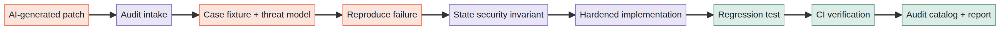

# Secure AI Code Audit Lab

A practical, reproducible lab for reviewing AI-generated backend code before it reaches production. Each case starts with a plausible implementation, states the security invariant that must hold, demonstrates the failure, provides a hardened alternative, and locks the lesson in with a regression test.

This is an independent audit lab inspired by real code-review concerns. It is not a copy of another repository: the scenarios, implementations, structure, wording, and verification workflow are designed around a different threat model and a different set of backend failure patterns.

## What this repository demonstrates

- Turning vague security concerns into explicit invariants.
- Reproducing concurrency, boundary, URL parsing, and authorization failures.
- Separating an unsafe fixture from a production-oriented remediation.
- Writing regression tests that exercise the dangerous input or execution path.
- Keeping audit evidence readable for engineers, reviewers, and coding agents.
- Publishing a machine-readable catalog alongside human-readable case notes.

## Audit catalog

| Case | Risk | Security invariant | Regression focus |
| --- | --- | --- | --- |
| Concurrent idempotency gate | High | One event ID is accepted at most once | 256 concurrent duplicate deliveries |
| Storage-root containment | Critical | Resolved paths stay below the configured root | `..`, nested traversal, and null-byte names |
| Callback URL validation | High | Only exact HTTPS hosts receive callbacks | lookalike domains, credentials, HTTP, and ports |
| Tenant-scoped authorization | Critical | Resource access stays within caller tenant scope | cross-tenant admin and missing-scope denial |

Every case directory contains:

```text
case.json          machine-readable risk and invariant metadata
AUDIT.md           evidence, reasoning failure, remediation, and lesson
starter.py         deliberately unsafe fixture
fixed.py           hardened reference implementation
test_regression.py executable security regression tests
```

## Architecture



The workflow is intentionally evidence-first:

```text
AI-generated patch -> threat model -> reproduce failure -> define invariant
       -> hardened implementation -> regression test -> CI -> audit catalog
```

The source diagram is [`docs/architecture.mmd`](docs/architecture.mmd).

## Requirements

- Python 3.11 or newer.
- `pip` and a virtual environment.
- Docker is optional.
- No network calls, database, API key, or cloud account is required.

The only runtime dependency is pinned in [`requirements.txt`](requirements.txt).

## Step-by-step installation

### Local environment

```bash
git clone https://github.com/Sunanda-devops/ai-code-audit-lab.git
cd ai-code-audit-lab
python3.11 -m venv .venv
source .venv/bin/activate
python -m pip install --upgrade pip
python -m pip install -r requirements.txt
```

### Run the complete lab

```bash
pytest
```

Expected result: all case regression tests pass.

### Generate the audit catalog

```bash
python -m audit_lab
python -m audit_lab --format markdown --output audit-catalog.md
python -m audit_lab --format json --output audit-catalog.json
```

The CLI only catalogs the declared audit cases; `pytest` is the executable verification gate for the hardened implementations.

### Docker

```bash
docker build -t secure-ai-code-audit-lab .
docker run --rm secure-ai-code-audit-lab
```

## Configuration

The lab intentionally has no secret configuration. Reproducibility comes from:

- Python 3.11 in CI.
- Exact `pytest` pinning.
- Synthetic inputs and local-only fixtures.
- No environment-dependent network behavior.
- Explicit test inputs for every security boundary.

The package metadata and pytest discovery rules are in [`pyproject.toml`](pyproject.toml). The catalog runner discovers `case.json` files under `cases/`, so adding a new audit does not require editing a central README table.

## How to add a new audit case

1. Create `cases/case_05_<short_name>/`.
2. Add `case.json` with `id`, `title`, `severity`, `invariant`, `threat`, and `verification`.
3. Add a minimal unsafe `starter.py` that preserves the failure mode.
4. Add `fixed.py` with the smallest clear remediation.
5. Add `AUDIT.md` explaining evidence, severity, reasoning failure, and the operational caveat.
6. Add `test_regression.py` that attacks the boundary, not just the return type.
7. Run `pytest` and regenerate the catalog.
8. Update the architecture only if the new case changes the workflow.

## CI and quality gates

GitHub Actions runs on every push and pull request:

1. Installs Python 3.11.
2. Installs the pinned requirements.
3. Runs all regression tests.
4. Generates a Markdown audit catalog.
5. Uploads the catalog as a workflow artifact.

Workflow: [`.github/workflows/ci.yml`](.github/workflows/ci.yml).

## Troubleshooting

### `ModuleNotFoundError: pytest`

Activate the virtual environment and install dependencies again:

```bash
source .venv/bin/activate
python -m pip install -r requirements.txt
```

### Relative-import errors in a case

Case directories must remain valid Python package names, such as `case_04_tenant_authorization`. Do not use hyphens in a case directory name when regression tests use relative imports.

### A concurrency test is flaky

The assertion should verify an invariant, not rely on a particular thread schedule. Keep the critical section in the fixed implementation and increase the replay count before weakening the test.

### A URL validation test passes unexpectedly

Test parsed components rather than raw string prefixes. Include userinfo, lookalike domains, alternate ports, schemes, and case normalization. Never make a live network request to prove an allowlist.

### Authorization test is too permissive

Authentication, role, and tenant ownership are separate decisions. Require both caller and resource scope, and default to denial when either scope is missing.

### Docker is using stale source

Rebuild without cache:

```bash
docker build --no-cache -t secure-ai-code-audit-lab .
```

## Project layout

```text
audit_lab/                    Catalog CLI and report formatters
cases/case_01_idempotency_race/  Concurrency and duplicate side effects
cases/case_02_path_traversal/    Filesystem boundary enforcement
cases/case_03_ssrf_allowlist/    URL parsing and host allowlists
cases/case_04_tenant_authorization/ Tenant isolation policy
docs/                         Architecture source and rendered diagram
.github/workflows/            CI quality gates
Dockerfile                    Reproducible test container
requirements.txt              Pinned test dependency
```

## Visual evidence

This is a code-audit lab rather than a web UI. The architecture diagram is the most useful stable visual asset; the generated Markdown catalog is the review-friendly equivalent of a screenshot and can be attached to CI runs or code-review discussions.

## License

MIT
